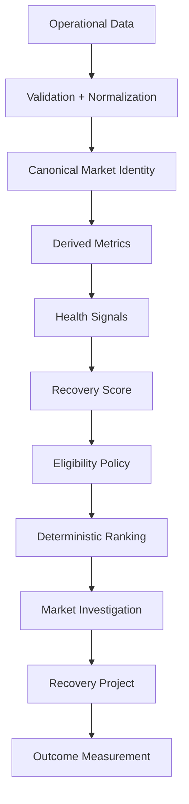
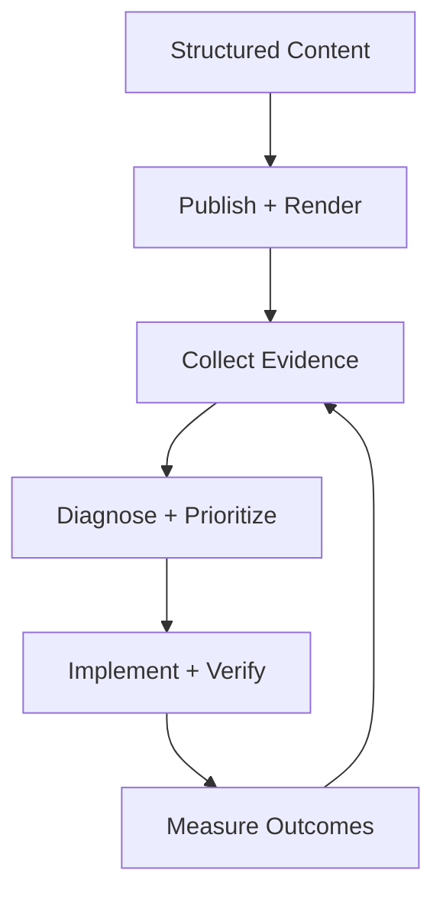

# Kasey Alexander Pelchy

**Business Systems · Revenue Operations · HubSpot · Application Development · Automation · Data & Integrations**

I work in HubSpot support and Revenue Operations at **protocol80**, building on a background in marketing operations, technical operations, custom business software, integrations, databases, analytics, and production troubleshooting.

I design around the operational requirement first: **business problem → process → data model → implementation → testing → measurement → improvement**. My experience spans the full lifecycle of internal applications and operational systems—from discovery and requirements to data pipelines, automation, reporting, deployment, and support.

My newer work extends that engineering foundation into **CRM architecture, sales-process configuration, HubSpot onboarding, workflow troubleshooting, data quality, and cross-platform RevOps implementation**. I also build independent websites and business applications through **Cwlwm Systems**.

This account contains both **public technical showcases** (sanitized demonstrations of proprietary systems) and **working repositories** (applications and websites). The public showcases should not be mistaken for complete production source releases. Employer/client implementations may not be public.

**[Explore the interactive portfolio](https://kaseys-portfolio.vercel.app)** · **[View the portfolio source](https://github.com/kaseypelchy-ops/portfolio)** · **[Cwlwm Systems projects](https://github.com/cwlwmsystems)**
---

## Areas I Work Across

HubSpot CRM & Onboarding · Revenue Operations · Sales Process Design · CRM Objects, Properties & Associations · Workflow Automation · Data Migration & Quality · API & SaaS Integration · Marketing Operations · Service Operations · Full-Stack Applications · PostgreSQL & Data Modeling · Reporting & Analytics · AI-Assisted Operations · Geospatial Data · SEO / AEO / GEO · Technical Support & Troubleshooting

---

## Technology

**Languages**  
TypeScript · JavaScript · Python · PHP · SQL · PL/pgSQL · HTML · CSS

**Application & Data**  
React · Next.js · PostgreSQL · Supabase · DuckDB · WordPress

**Cloud & Integration**  
Vercel · Google Cloud · GitHub Actions · REST APIs · Cloud Tasks · JSON · JSONB · JSON-LD

**Marketing, Search & Analytics**  
HubSpot · Google Search Console · Google Analytics 4 · Bing Webmaster Tools · Mautic · Klaviyo · ACF · Schema.org

**Data & Spatial**  
Shapely · PyProj · KML / KMZ · FCC Broadband Fabric · Geospatial Processing

---

## Certifications

**HubSpot Revenue Operations Certified** · **HubSpot Inbound Certified**

---

# Recent Work: CRM, Business Systems & Independent Projects

## HubSpot & RevOps Implementation Work

At protocol80, I support guided HubSpot onboarding and hands-on CRM configuration work. My responsibilities include understanding client sales and marketing processes, mapping requirements to CRM properties and pipelines, configuring record experiences and workflows where the engagement permits, assisting with imports and integration troubleshooting, and documenting decisions and next steps.

**Representative work patterns:** lead-to-deal handoffs · pipeline/stage definitions · conditional discovery properties and record cards · meeting and task workflows · legacy-system data mapping · integration troubleshooting · HubSpot implementation guidance.

**Note:** This is a description of my role and technical patterns, not a claim that employer or client configuration is publicly available or independently owned. Client-specific data and implementation details remain private.

## Olson & Tenglund — Automotive Retail Systems

Two distinct projects for a regional automotive-parts business:

- **[Operational storefront and inventory workspace](https://github.com/kaseypelchy-ops/olson-tenglund):** Next.js application architecture covering a vehicle finder, product/SKU data, fitment records, supplier catalog workflows, protected staff administration, database migrations, and CSV imports. The public repository documents the system, not a guarantee that a populated live catalog or ecommerce checkout has launched.
- **[Informational business website](https://github.com/kaseypelchy-ops/olson-tenglund-info):** Responsive business website representing three retail locations, store information, and brand transition. The site and broader engagement include practical search visibility and business-presence work.

**Skills demonstrated:** Next.js · database design · data import workflows · admin authentication · responsive web development · technical SEO · local business systems.

## Community & Small-Business Web Projects

- **[Church website](https://github.com/kaseypelchy-ops/church-website):** Website development repository; project status and scope should be checked in the repository before treating proposed functionality as shipped.
- **[Cwlwm Systems organization](https://github.com/cwlwmsystems):** Independent client and community work, including public-facing websites and operational applications.

---

# Featured Engineering Showcases

## Market Recovery Intelligence Platform

I built a full-stack market-intelligence and decision-support platform for identifying declining markets, investigating the underlying causes, prioritizing recovery opportunities, and measuring intervention outcomes.

The system combines acquisition activity, churn behavior, subscriber history, market identity, lifecycle state, and recovery-project data into a canonical analytical model.

Operational evidence is normalized before analytics are calculated. Multi-horizon trends and health signals feed a coverage-aware scoring model, while a separate policy layer determines whether a market is actually eligible for action.

Eligible candidates are then ranked deterministically for investigation.

**Selected engineering work:** canonical data modeling · multi-horizon trend analysis · coverage-aware scoring · data-completeness modeling · deterministic ranking · transactional project creation · immutable measurement baselines · analytical read-path optimization · shared TypeScript domain modules · database indexing · regression validation

**Stack:** Next.js · React · TypeScript · PostgreSQL · Supabase · SQL · Data Engineering · Analytics

**[View the technical showcase →](https://github.com/kaseypelchy-ops/market-recovery-platform-showcase)**  
**[Open the live interactive demo →](https://kaseypelchy-ops.github.io/market-recovery-platform-showcase/)**

---

## Field Sales Operations Platform

I built a field-sales operations platform that connects serviceable-address data, territory management, door-to-door canvassing, customer dispositions, pricing, installation scheduling, sale submission, post-sale review, invoicing, and management reporting.

Field representatives get an address-centered mobile workflow, while operations and leadership receive centralized visibility into sales activity, installation capacity, territory performance, representative activity, lifecycle outcomes, and operational trends.

The platform is designed for real field conditions, including unreliable connectivity, shared installation capacity, realtime updates, transactional sale workflows, and preservation of unsynced work.

**Selected engineering work:** transactional sales workflows · PWA/offline synchronization · realtime reconciliation · installation-capacity management · pricing snapshots · duplicate-safe customer notifications · lifecycle tracking · PostgreSQL functions · role-based workflows · data-quality controls · reporting · cross-system integration

**Stack:** JavaScript · HTML / CSS · PostgreSQL · PL/pgSQL · Supabase · Vercel · Leaflet

**[View the FieldOS showcase →](https://github.com/kaseypelchy-ops/fieldos-project-showcase)**

---

## AI Call Quality & Coaching Platform

I built an AI-powered quality assurance, coaching, and management analytics platform for customer-service calls.

Completed call recordings move through an asynchronous processing pipeline that validates eligibility, prevents duplicate analysis, performs structured AI evaluation, applies deterministic scoring, persists the result, and routes the output into coaching and management workflows.

The architecture separates ingestion, queueing, AI analysis, application scoring, persistence, notification delivery, coaching, and reporting so failures in one stage do not silently compromise the rest of the process.

**Selected engineering work:** queue-based processing · idempotent analysis · structured LLM output · deterministic scoring · asynchronous workers · retry handling · processing locks · automated notifications · coaching workflows · effectiveness measurement · operational-health monitoring · management analytics

**Stack:** Python · TypeScript · React · Next.js · PostgreSQL · PL/pgSQL · Supabase · Google Cloud · Cloud Tasks · Vercel · AI / LLMs

**[View the AI Call Quality showcase →](https://github.com/kaseypelchy-ops/ai-call-quality-platform-showcase)**

---

## SEO, AEO & Search Intelligence Platform

I built and continue to develop a production search-operations platform connecting structured website content, technical site health, organic-search performance, optimization workflows, and AI-visibility measurement.

The project began as a database-driven SEO and Answer Engine Optimization system. Pages, geographic relationships, services, promotions, keywords, FAQs, content sections, internal links, redirects, metadata, and publishing state are modeled in PostgreSQL and Supabase. Reusable WordPress templates retrieve page-level JSON bundles and dynamically render localized content, metadata, and structured data.

That foundation helped expand localized website coverage from approximately 25 manually maintained pages to more than 435 dynamic market and service-area pages.

The system has since expanded into a protected Next.js application combining managed page data, live rendered-site evidence, Google Search Console performance, GA4 AI referral data, Bing AI citation evidence, automated monitoring, prioritization models, internal-link workflows, and optimization experiments.

The platform deliberately preserves source meaning: Search Console performance, rendered-site health, identifiable AI referrals, and AI citations can be compared operationally without being blended into fabricated metrics. It also distinguishes **not measured** from **measured zero** and retains import lineage for auditable results.

**Selected engineering work:** relational content modeling · reusable WordPress publishing · Search Console integration · intent and page-ownership intelligence · opportunity prioritization · content-gap and cannibalization analysis · rendered-site health monitoring · internal-link execution and verification · optimization experiments · GA4 AI-referral measurement · Bing AI citation intelligence · pipeline operations · explainable scoring and guardrails

**Stack:** Next.js · React · TypeScript · PostgreSQL · Supabase · WordPress · PHP · Google Search Console · Google Analytics 4 · Bing Webmaster Tools · REST APIs · JSONB · JSON-LD · Vercel

**[View the SEO, AEO & Search Intelligence showcase →](https://github.com/kaseypelchy-ops/seo-aeo-content-platform-showcase)**

---

## Fiber Service Area Mapping Pipeline

I built a geospatial data pipeline that converts KML/KMZ service-area boundaries into structured broadband-location datasets.

The pipeline parses and repairs source geometry, calculates a service-area bounding box, uses DuckDB to reduce a large FCC Broadband Fabric dataset to a candidate set, and then performs exact point-in-polygon matching with Shapely.

Matched locations are deduplicated, normalized, enriched with selected geographic attributes, and exported as structured JSON and CSV for downstream systems.

The cloud workflow also includes generation-aware duplicate protection, processing locks, stale-lock recovery, lineage tracking, and optional cost-controlled geocoding fallback.

**Selected engineering work:** geometry parsing and repair · coordinate transformations · bounding-box filtering · DuckDB query optimization · point-in-polygon analysis · streaming record processing · normalization · deduplication · processing locks · stale-lock recovery · lineage tracking · cloud automation

**Stack:** Python · DuckDB · SQL · Shapely · PyProj · Google Cloud · KML / KMZ · FCC Broadband Fabric

**[View the Fiber Mapping showcase →](https://github.com/kaseypelchy-ops/fiber-service-area-mapping-showcase)**

---

# How I Build

I start with the process rather than the technology.

I look for places where:

- work is repetitive
- information is disconnected
- important decisions depend on manual analysis
- reporting is difficult
- multiple systems need to communicate
- existing software does not match the real workflow
- a process works at small scale but becomes difficult to manage as it grows

From there, my usual approach is:

1. **Map the workflow and decision points**
2. **Identify the entities, state, and business rules**
3. **Design the data model**
4. **Separate source evidence from analytical and operational logic**
5. **Choose the smallest architecture that can solve the problem reliably**
6. **Build for retries, failure, changing data, and changing requirements**
7. **Validate the system against the real workflow**
8. **Turn the output into something useful for the person making the decision**

The technology is a means to solve the business problem, not the starting point.

---

# Engineering Principles

### Model the process before the interface

The workflow, data relationships, state transitions, and rules should be understood before the UI dictates the architecture.

### Preserve clear sources of truth

When multiple screens or services depend on the same logic, I prefer shared domain rules and canonical data sources over duplicated implementations.

### Separate evidence from decisions

Raw data, analytical interpretation, and operational policy are different concerns. Keeping them separate makes systems easier to explain, test, and change.

### Treat missing data explicitly

Missing information should remain missing rather than silently becoming a healthy value, successful result, or false certainty.

### Design for failure and retries

Imports can be repeated. Workers fail. Connections drop. Users retry actions. Systems should expect those conditions rather than assume perfect execution.

### Preserve history

Changing today's configuration should not silently rewrite what happened yesterday. Historical decisions, pricing, measurements, and baselines should remain explainable.

### Build for the person making the decision

A technically correct system still fails if the person using it cannot understand the output or determine what to do next.

---

# What I Bring

I am comfortable moving between the business and technical sides of a problem — from defining the objective and workflow to modeling the data, designing the architecture, building the system, validating it, and using the resulting information to support operational decisions.

My background in marketing and operations shapes how I approach software, data, and process design. I understand the customer-acquisition and lifecycle side of the work as well as the systems required to support it.

I tend to start with four questions:

**What problem needs to be solved?**  
**Who needs the answer?**  
**What evidence is required to make the decision?**  
**How can the process become repeatable?**

Then I determine what should be built to make that happen.

My work sits at the intersection of **Marketing Operations, Revenue Operations, marketing technology, business systems, software engineering, data, analytics, automation, and AI**.

---

## About the Public Showcases

The repositories linked above are sanitized portfolio representations of privately maintained production systems and engineering work.

Production source code, credentials, customer or employee information, proprietary company data, internal infrastructure, confidential pricing, private operational metrics, and company-specific business rules are intentionally excluded.

The public repositories use combinations of:

- synthetic data
- generalized code samples
- neutral schema names
- technical documentation
- architecture diagrams
- representative SQL and TypeScript
- sanitized screenshots
- interactive reconstructions

The goal is to demonstrate the engineering approach without exposing private systems or data.

---

## Connect

**[Interactive Portfolio →](https://kaseys-portfolio.vercel.app)**  
**[GitHub →](https://github.com/kaseypelchy-ops)**  
**[LinkedIn →](https://www.linkedin.com/in/kaseypelchy19/)**
